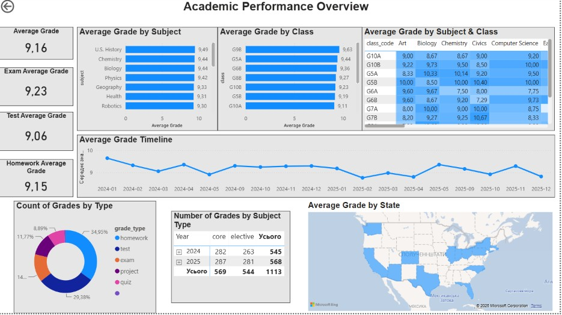
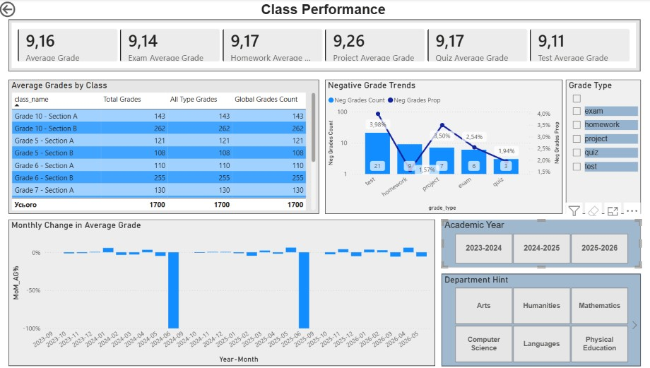
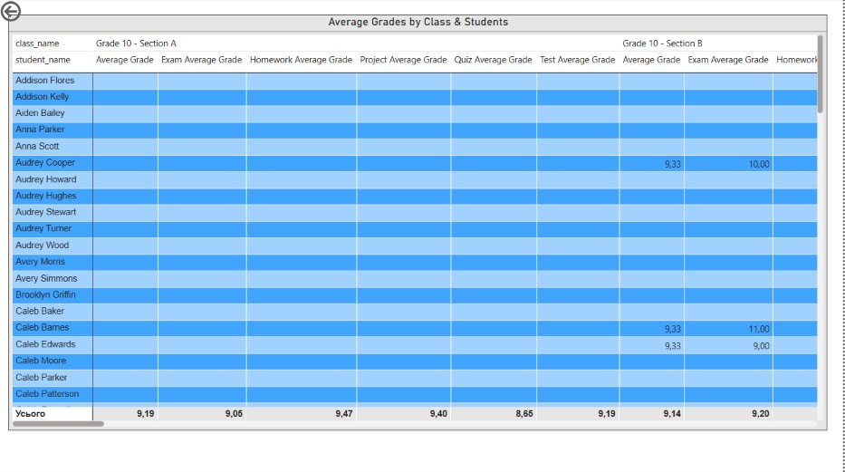
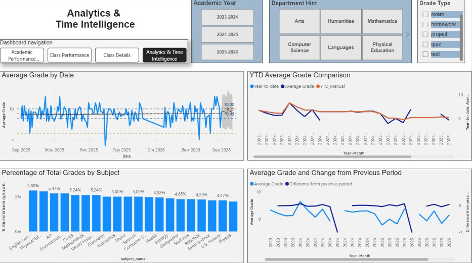
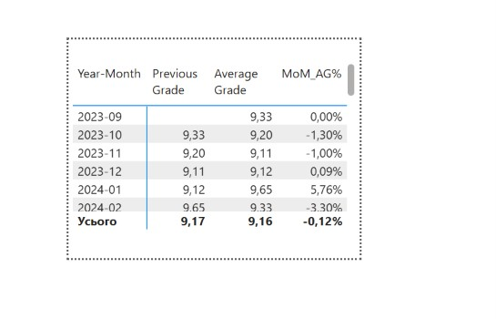

# Academic Performance Analysis | Power BI

## Project Overview

This project presents an interactive Power BI dashboard for analyzing student academic performance.

The dashboard helps explore grade trends, compare results across classes and subjects, and monitor changes over different school years.

The project uses a sample dataset that simulates a school's electronic gradebook.

## Dashboard Preview

### 1. Academic Performance Overview

### 2. Class Performance

### 3. Class Details

### 4. Analytics & Time Intelligence

### 5. Month-over-Month Analysis

## Business Objective

The goal of this project is to create an interactive dashboard for monitoring student performance and analyzing academic results.

The analysis focuses on five main areas:

**1. Overall Academic Performance**
- Assess overall student performance.
- Analyze grade distribution.
- Calculate the percentage of negative grades.

**2. Comparison of Academic Results**
- Compare average grades across classes and subjects.

**3. Identifying Areas of Concern**
- Identify classes with a high percentage of negative grades.
- Identify subjects with lower academic results.

**4. Academic Performance Trends**
- Track changes in average grades over time.
- Analyze month-to-month changes in average grades.

**5. Grade Distribution Analysis**
- Analyze the distribution of grades across subjects.
- Compare grade distribution across school years.

## Tools & Technologies

**Power BI**
- Dashboard development and data visualization.
- DAX measures and calculations.
- Interactive filters and drill-down.

**Power Query**
- Data cleaning and transformation.
- Data type and date format correction.

**Data Modeling**
- Star schema design.
- Relationships between tables.
- Calendar table creation using DAX.

## Data Preparation & Modeling

- Cleaned and transformed data in Power Query.
- Corrected data types and date formats.
- Built a star schema data model with fact and dimension tables.
- Created relationships between tables.
- Created a calendar table using DAX.

## Key Metrics & Analysis

The dashboard includes the following key metrics:

- **Average Grade** – average student grade.
- **Negative Grades Count** – number of grades below the passing level.
- **Negative Grades Percentage** – share of negative grades in the total number of grades.
- **Month-over-Month Change** – monthly change in average grades compared to the previous month.
- **Previous Month Average Grade** – average grade for the previous month, used for comparison.

The dashboard also allows users to:

- Compare academic results across classes and subjects.
- Explore grade distribution by assessment type.
- Analyze changes in academic performance across school years.

## Key Findings

The analysis shows that:

- Overall academic performance remains relatively stable across the analyzed school years.
- Differences in average grades across classes vary, with no consistently lowest-performing class.
- Tests and projects have a higher percentage of negative grades compared to other assessment types.

**Note:** Sharp drops in monthly average grade change in August are related to summer school holidays, when no student assessments take place. These changes do not indicate a decline in academic performance.
